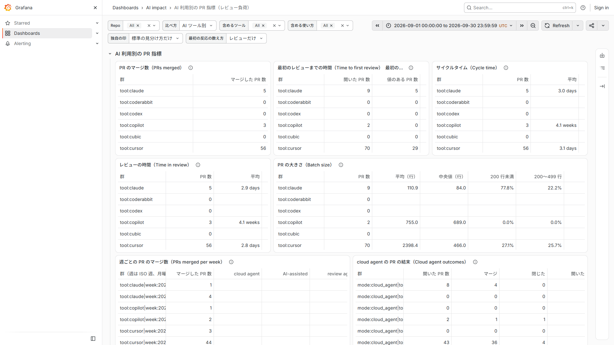

# AI ツール別の PR 指標を、自社の DevLake で持つ

有料の AI 分析サービスが出している「AI ツール別・使い方別の、プルリクエスト（PR）の指標」を、無料の Apache DevLake の上に、定義を並べて作り直した物です。Grafana の 1 枚の画面で、Claude・Cursor・Copilot などのツール別に、マージ数・最初のレビューまでの時間・サイクルタイム・レビューの時間・変更の大きさを比べられます。
Apache DevLake は、GitHub などの開発の記録を集めて分析する OSS です。Grafana は、データベースの値を表やグラフで見せる OSS の画面ツールで、DevLake の画面はこれで作られています。
向ける先は、AI 駆動開発を進める推進担当の方です。「有料のサービスを買うか、自社で持つか」を選ぶための材料として作りました。
記録（`docs/`）に出てくる略号（作った順の段階の名前、公開していない作業計画の名前、出所の表の行番号など）は、[用語集](docs/glossary.md)（英語）に説明があります。

結果：公開 repo 2 本の 2026 年 9 月の PR 297 本を、GitHub の生データから別の script で計算し直した値と突き合わせ、7,062 項目すべてが一致しました（`docs/validation/u4-real-data.md`）。ソフトの費用は 0 円です（Docker Desktop の利用条件などは「費用の比較」の節）。最後に確かめた日：2026-10-21。



画面は、手元の DevLake に取り込んだ公開 repo 2 本の、2026-09-01〜2026-09-30（UTC）の実データです。人の名前や login は画面に出しません（ツールの bot の名前は出します）。

## 既存の物との違い

PR の指標を出す物は、無料の物にも有料の物にも既にあります。この作品は、その並びの中の「自社で持つ」側の 1 つです。

| 物 | 何をするか | この作品との違い |
|---|---|---|
| 有料の AI 分析サービス | AI ツール別・使い方別に、PR の指標を比べる | 内部の計算は見られず、費用が人数にかかる。この作品は定義を行ごとに並べ、SQL を自社で変えられる。ただし有料の側には、小さい組織向けの無料の枠と、この作品に無い機能がある（次の節以降） |
| GitHub の issue-metrics（MIT） | 検索で選んだ issue・PR の、最初の反応までの時間などを、GitHub の issue に報告として書き出す。除くのは作者自身と bot のコメント。[README](https://github.com/github-community-projects/issue-metrics) | AI ツール別の比べ方は無い。この作品は PR の作者・共同作者の記録などからツールを見分け、ツール別に並べる |
| mitzu の pr-metrics（MIT） | PR の履歴から 1 枚の HTML の画面を作る。LLM（API キーか Claude Code）を使うのは、PR のカテゴリ（種類）の分類だけ。AI-assisted かどうかは規則で決める（merge commit の `Co-Authored-By` の trailer、PR 本文の印、ラベルのどれか）。AI-assisted の割合は 1 つで、ツール別・使い方別の比べ方は無い。[README](https://github.com/mitzu-io/pr-metrics) | この作品は、PR 自身の commit の記録から、ツール別・使い方別に分ける（merge commit は読まない。ADR 0002 の D15）。LLM は使わず、規則（正規表現）だけで見分ける |
| fieldnote（AGPL-3.0） | AI が書いた PR を、CI の通り方（最初の 1 回で緑になるか）などで見る。[README](https://github.com/dervalp/fieldnote) | 見る対象が違う（CI の結果）。この作品は人のレビューの負担を見る |
| DevLake 本家の AI 向けの画面 | DevLake v1.0.3-beta18 の 70 ファイル（うち 1 組は同じ内容）のうち、Copilot・Cursor・Kiro の画面は、各ツールの利用データの表（`_tool_copilot_*`・`_tool_cursor_*`・`_tool_kiro_*`）を読む。Claude Code の画面 2 枚（ClaudeCodeAdoption・ClaudeCodeAdoptionByUser）も、`_tool_claude_code_*` の表を読む。PR の作者や `Co-authored-by` で AI ツールを見分ける SQL は、70 ファイルの中に 0 件。[dashboards](https://github.com/apache/devlake/tree/v1.0.3-beta18/grafana/dashboards) | 本家の画面は各ツールの利用データが前提。この作品は GitHub の PR の記録だけから見分ける。DevLake を土台に、本家に手を入れずに足している |

この作品が合うのは、次のような場合です。

- 10 人以上で、費用を抑えたい。
- ツールの見分け方・数え方を、自社の事情に合わせて変えたい。

有料のサービスが合う場合もあります。次のことは、この作品ではできません。

- 小さい組織向けの無料の枠が使える（費用の比較の節）。
- 利用時間からの判定、Merge percentage、チーム別の内訳など、この作品に無い機能がある（「できないこと」の節）。
- 自分で動かす機械と保守が要らない。

## 定義の対応表

有料の AI 分析サービス（Swarmia の「AI impact」）の公式文書の定義を、行ごとに並べました。定義を揃えたと言えるのは、この表で行ごとに原文と定義を並べた範囲だけです。Swarmia は契約していないため、**Swarmia の内部の計算や数値と、この作品の数値が一致するかは確かめられません**。Swarmia との提携・保証はありません。原文の引用、各行の判断（D1〜D17）、出所の行番号は [ADR 0002](docs/adr/0002-swarmia-parity-definitions.md) にあります。

| # | Swarmia の指標・比べ方 | この作品 | 差 |
|---|---|---|---|
| S1 | Time to first review | 作った | PR を開いた時刻から数える（DevLake にレビュー依頼の時刻が無いため。D1）。原文は承認と変更の要求だけを挙げているが、状態が COMMENTED（コメント付き）や DISMISSED のレビューも、最初の反応に数える（D2。これは私の解釈）。レビューではない普通のコメントは、画面の選択「最初の反応の数え方」を「コメントも」にした時だけ数える（D16）。bot と PR の作者自身は除く |
| S2 | Time in review | 作った | マージされた PR だけ。開始は S1 と同じ。終わりは最後の承認（承認が無ければ merge。D5・D9） |
| S3 | Cycle time | 作った | マージされた PR だけ。3 つの区間の和（最初の commit か PR を開いた時の早い方から最初のレビュー依頼まで・レビュー・最後の承認から merge まで）。レビュー依頼の時刻が無いので、依頼は PR を開いた時とする（D1）。下書きの状態は区別しない（D4） |
| S4 | Throughput（PRs merged） | 作った | 期間内にマージした数。週ごとの表もある（D6） |
| S5 | Batch size | 一部 | 追加＋削除の行数。200 行未満・200〜499 行・500 行以上の割合を出す。**生成ファイルの自動除外はしない**（対象の一覧が公開されていない） |
| S6 | 比べ方「AI tools」 | 作った | ツールごと対それ以外。1 本の PR を複数のツールに数える（重複を許す）。bot でも agent ではない物（dependabot など）は「それ以外」に入る |
| S7 | 比べ方「Modes」 | 作った | cloud agent・AI-assisted・review agent の 3 区分。見分けの login は、各ベンダーの公開文書か公開 PR で確かめた物だけを既定の一覧に入れた（`docs/agent_identities.md`）。**commit の作者の見分けは、GitHub のアカウントではなく git の名前とメールで照合する**（名前の違う commit は見えず、同じ名前の人は agent に見える）。**review agent は、正式なレビューの行だけを数える**：要約のコメントだけを書く review agent（CodeRabbit の要約コメントなど）は、有料の側は数えるが、この作品は数えない（D13） |
| S8 | 比べ方「AI used」 | 作った | いずれかの区分に入る PR 対それ以外（D7） |
| S9 | 確度の高い物だけ | 同じ範囲 | 確度の高い見分けだけを作った。**AI ツールの利用時間による判定は作らない**（ベンダーの利用データが要る） |
| S10 | `claude-code-assisted` のラベル | 使わない | ラベルはマージされた PR にだけ付き、結末の比較が偏るため |
| S11 | cloud agent の PR の数と結末 | 作った | S7 の cloud agent の群で数え直した。PR は作者のまま agent の群に数え、有料の側のように、agent を始めた人には結びつけない |
| S12 | Merge percentage | 作らない | 計算の式が原文に無い |
| S13 | Agent commit percentage | 作らない | 区分の境目が原文に無い |
| S14 | エージェントの PR の裏にいる人 | 一部 | GitHub の PR の担当者を DevLake に足す script を付けた（`importer/`、ADR 0003。DevLake 本家の取り込みは担当者を書かない）。ただし担当者のデータは、最初の人の反応から担当者を除いた値にだけ使う。PR を裏にいる人に結びつける指標は無い |

この作品だけの指標もあります：レビューの件数・差し戻しの割合・最初の人の反応（ADR 0001）。ほかに、PR 本文の印や branch の接頭辞で見分ける「独自の印」は、原文に無い追加として画面で切り替えにしました。

## 費用の比較

| | 費用 | 出所 |
|---|---|---|
| Swarmia 無料の枠 | 9 人まで | 「Swarmia is free for companies with up to 9 developers.」（[pricing](https://www.swarmia.com/pricing/)、2026-10-20 に取得） |
| Swarmia「Productivity & AI impact」 | 1 人・月 $23（年払い） | 同上。AI の分析だけを使うなら、この単品が比べる相手 |
| Swarmia「Standard」 | 1 人・月 $45（年払い） | 同上 |
| この作品 | ソフトの費用は 0 円（DevLake は Apache-2.0、この作品は MIT）。動かす機械・保守・GitHub のトークンの管理は自社持ち | |

Docker Desktop の利用条件：この作品は DevLake を Docker で動かします。Docker Desktop は、従業員 250 人未満かつ年間売上 1,000 万ドル未満の小規模企業・個人利用・教育・非商用の OSS では無料で、大きい組織の業務利用・政府機関・無料の範囲を超える商用の利用では有料の契約が要ります（[Docker 社の文書](https://github.com/docker/docs/blob/a356e2a80e84ccc7cfbfa371bb1167db2bab5c2f/content/manuals/subscription-billing/desktop-license.md)、2026-10-21 に取得）。Docker Engine などの OSS の条件は変わらない、と同じ文書が書いています。ご自身の条件を、導入の前に確かめてください。
Swarmia の価格は、他の人数・年払いでない場合・今の価格と違うことがあります。

## 正しさの証拠

- **合成データの試験**（SQL が自分の定義どおりに動く証拠です。元のサービスと同じ品質の証拠ではありません）。正解は PR ごとに手で計算しました。最後の行：最初の 5 指標 `119 values compared, 0 mismatches`、定義に揃えた指標 `734 values compared, 0 mismatches` と `736 values compared, 0 mismatches`（独自の印なし・あり）、最初の 5 指標との突き合わせ `21 values compared, 0 mismatches`、PR の担当者の取り込み script `89 checks, 0 failures`、画面の組み立てと選択 `127 checks, 0 failures`・`1827 checks, 0 failures`、DevLake の設定の script `103 checks, 0 failures`、SQL を実際の DevLake で走らせる script `17 checks, 0 failures`、導入の script `128 checks, 0 failures`・`93 checks, 0 failures`。
- **変異試験**（SQL や script を 1 か所ずつ壊して、試験が落ちるかを見る）：ADR 0002 付録 B で 53 件、ADR 0004 の付録 A で 57 件・付録 C で 78 件、ADR 0003 で 13 件（`python tests/importer/test_importer.py --mutants`、最後の行 `13 mutants, 13 caught`）、DevLake の設定の script で 9 件（`python tests/tools/test_devlake_configure.py --mutants`、最後の行 `9 mutants, 9 caught`）。いずれも生き残りは 0 です。
- **実データ**：公開 repo 2 本（MIT）の、2026 年 9 月に開いた・マージした PR 297 本。GitHub の API の生データから別の script で計算した値と、DevLake に流した SQL の値が、297 本・7,062 項目すべて一致しました。同じ DB に対して 3 回走らせました（`docs/validation/u4-real-data.md`）。1 回目は 253/297 本が一致で、SQL の誤り 2 つ（A1・A2）が見つかり、直しました。2 回目は 292/297 本で、残る 5 本の原因は、SQL が commit の本文を `commits` の表だけから読んでいたことで、SQL を直しました（D15）。3 回目が 297/297 本です。突き合わせの script と生データには人の login が入るため、公開していません。
- **画面の値と送られた SQL**：実際の画面で、表の値が突き合わせの値と一致し、画面が送った SQL が試験で使った SQL と同じことを確かめました（ADR 0004 付録 B）。

## 使っている物

Apache DevLake v1.0.3-beta18、MySQL 8.4、Grafana 13.2.2、Docker、Python（標準ライブラリだけ。この repo の script と試験は、追加のパッケージを入れずに動きます）。

## 導入の手順

DevLake を手元の PC で動かす場合の手順です（Git Bash で打ちます）。`<composeのフォルダ>` は、DevLake の `docker-compose.yml` があるフォルダの path に、山かっこごと置き換えます。

1. DevLake v1.0.3-beta18 を、公式の Docker Compose の手順（[Install via Docker Compose](https://github.com/apache/devlake-website/blob/4162feefe9bc75ae952100cb668e7265816bdec4/docs/GettingStarted/DockerComposeSetup.md)）で起動します。リリースの [docker-compose.yml](https://github.com/apache/devlake/releases/download/v1.0.3-beta18/docker-compose.yml) と `env.example` を 1 つのフォルダに置き、`env.example` を `.env` にして、手順書のとおり `ENCRYPTION_SECRET` を決めます。
   - 配布物の `docker-compose.yml` は、port を全部の接続先に開く形（`3002:3000`・`4000:4000`）です。手元からだけ開くため、`"127.0.0.1:3002:3000"`・`"127.0.0.1:4000:4000"` の形に書き換えます。
   - Grafana の管理者のパスワードは、Grafana の環境変数 `GF_SECURITY_ADMIN_PASSWORD` で決めます（値は、この README にも repo にも書きません）。既定のままにしません。
2. GitHub の接続（トークン）は、DevLake の画面（config-ui、`http://localhost:4000`）で作ります（[Tutorial](https://github.com/apache/devlake-website/blob/4162feefe9bc75ae952100cb668e7265816bdec4/docs/Configuration/Tutorial.md)）。トークンは画面にだけ打ちます。
3. 取り込みの設定を確かめて流します。
   ```
   python tools/devlake_configure.py plan --connection-id 1 --repos OWNER/NAME --project NAME
   python tools/devlake_configure.py apply --connection-id 1 --repos OWNER/NAME --project NAME --log log.txt
   ```
   説明：`docs/devlake_configure.md`。
4. PR の担当者を取り込みます（任意）：`docs/importer.md`。
5. Grafana 用の読み取り専用の DB 利用者を作ります（DevLake の持ち主が打ちます）。
   ```
   python tools/grafana_readonly_user.py plan  --compose-dir <composeのフォルダ>
   python tools/grafana_readonly_user.py apply --compose-dir <composeのフォルダ>
   ```
6. 画面を Grafana に入れます。
   ```
   python tools/grafana_install.py plan   --compose-dir <composeのフォルダ> --readonly-db
   python tools/grafana_install.py apply  --compose-dir <composeのフォルダ> --readonly-db
   python tools/grafana_install.py status --compose-dir <composeのフォルダ> --readonly-db --wait 120
   ```
7. ブラウザで `http://127.0.0.1:4000/grafana/d/ai-impact-pr` を開きます。画面を開いた後に `python tools/grafana_readonly_user.py status --compose-dir <composeのフォルダ>` を打つと、Grafana が `grafana_ro` で入っていることを確かめられます。

DevLake を `DATABASE_TYPE` の形で動かしている時は、DevLake の起動 script が `DATABASE_USER`・`DATABASE_PASSWORD`（既定は `merico`）を使い、`MYSQL_USER` を上書きします。接続先は 6 のファイルでも設定しているので、`status` で `merico` の接続が 0 本のことを確かめてください。詳しくは `docs/dashboard.md` と ADR 0004 です。

## 使い方の例

画面の上の選択で、表に出す物を変えます。

- 比べ方：「AI ツール別」（ツールごと対それ以外）、「使い方別」（cloud agent・AI-assisted・review agent 対それ以外）、「AI を使ったか」。
- 含めるツール・含める使い方：比べる物を絞ります。
- 独自の印：この repo 独自の見分け方（branch の接頭辞・PR 本文の `Co-Authored-By: Claude`）を足すかどうか。足すと、見つかる PR が増えます（上の実データでは、Codex の PR が 6 本現れます）。
- 最初の反応の数え方：「レビューだけ」か「コメントも」か（ADR 0002 の D16）。

画面の読み方は、画面の一番下の閉じた段にも書いてあります。

## 会社ごとの調整点

- **見分け方の追加と削除**：設定ファイル（JSON）に、ツールの名前と、作者・commit・共同作者・レビューの login の正規表現を書き、`python tools/build_dashboard.py --custom-tools FILE --out FILE` で自社用の画面を作ります。標準の行を外すこともできます（`docs/dashboard.md`）。
- **数え方の切り替え**：最初の反応を、レビューだけにするか、コメントも含めるか（画面の選択）。
- **担当者の取り込み**：PR の担当者を GitHub から読んで DevLake に足します（`docs/importer.md`）。
- **GitHub 以外の DevLake**：`_tool_github_commits` を読む箇所は、GitHub のプラグインが無い DevLake では差し替えが要ります（ADR 0002 の「Consequences and limits」）。
- 取り込みの script は、取り込む期間の始まりを 2026-06-01（日本時間）に固定して検査します（`tools/devlake_configure.py` の `TIME_AFTER`）。自社の期間にするときは、ここを変えます。

## できないこと

- **確度の低い判定**：AI ツールの利用時間からの判定は作っていません。ベンダーの利用データが要り、無料の範囲で確かめられないためです。
- **Merge percentage・Agent commit percentage・生成ファイルの除外**：計算の式や区分の境目、対象の一覧が、公式文書に無いので作っていません。
- **チーム別の内訳**：DevLake の team の表を使うかどうかを決めていないため、範囲外です。
- **GitLab での表示名による照合**：この作品は GitHub だけを対象にしているため、作っていません。
- **PostgreSQL 版**：MySQL だけで確かめているため（DevLake の既定が MySQL）、作っていません。
- **有料の側の数値との一致**：契約していないため、確かめられません（定義の対応表の節）。
- **レビュー依頼の時刻**：DevLake に無いので、最初の反応の時間は PR を開いた時から数えます。下書きの時間も含みます。
- **画面の変数の値と DB の権限**：Grafana の画面の変数の値は、画面の URL からも渡すことができ、検索（クエリ）に届きます。Grafana の文書は、Grafana は検索の安全性を検査しないので、データソースの DB 利用者には SELECT の権限だけを与えるよう勧めています（[Configure the MySQL data source](https://grafana.com/docs/grafana/latest/datasources/mysql/configure/)）。DevLake の既定のデータソースの利用者（`merico`）は書き込みの権限を持っています。そこでこの作品は、Grafana に読み取り専用の利用者 `grafana_ro`（`lake` への SELECT だけ）を使わせます（`tools/grafana_readonly_user.py`）。ただし `grafana_ro` は `lake` の全部の表（接続の設定の表、人の login を含む表）を読めます。画面は手元だけに置き、`lake` の全部を読んでよい人だけが開ける場所で使ってください。動画の録画のように、ログイン無しの閲覧を一時的に許している間は、ログインしていない人も読めます。
- **実データの更新**：突き合わせは 2026 年 9 月の PR を 2026-10-20 に取った時点の値です。その後の更新と、元のサービスの文書の変化への追従は、公開の後の手入れです。

## 作った経緯

動機：海外の企業などが有料で提供している AI 分析と同じ種類の指標を、自社で無料で持てるようにする技術が、これから求められるのではないかと、私は考えました（これは私の見方で、市場の調査に基づく事実ではありません）。AI ツールを入れた組織では、AI が出した PR が、人のレビューの負担をどれだけ増やすかが問われます。有料の分析はあるが、費用と、計算が見えないことが、導入の壁になりえます。

方法：まず、有料のサービスの公式文書の定義を行ごとに書き出し、DevLake の表で取れる物と取れない物に分けました（定義の対応表）。次に、定義を SQL にし、正解を手で計算した合成データで試験し、1 か所ずつ壊す変異試験で試験の強さも確かめました。それを実際の DevLake に流し、公開 repo の PR を GitHub の生データから別に計算した値と突き合わせました。最後に Grafana の画面にして、画面の値と送られた SQL も確かめました。決めた理由と捨てた案は、`docs/adr/` に 1 つずつあります。

結果：297 本・7,062 項目が一致しました（3 回目）。突き合わせで SQL の直しが 3 つ（A1・A2・D15）出て、直した後の結果です。画面は読み取り専用の DB 利用者で動きます。ただし、費用の比較の節と「できないこと」の節にあるとおり、有料の側の内部の数値との一致、無料の枠、この作品に無い機能は、そのまま残ります。

## ライセンス

MIT（`LICENSE`）。DevLake 由来の部分（表の形・median の計算など）は、`NOTICE` と Apache-2.0 の全文（`LICENSE-APACHE-2.0`）に従います。
